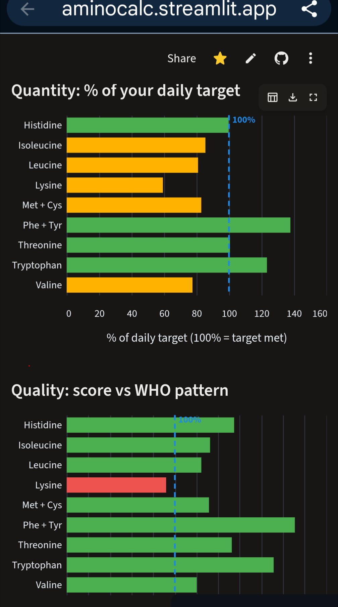

# AminoCalc

**Protein quality and nutrient profiler for meal plans, based on the WHO/FAO/UNU 2007 amino acid requirements.**

[](https://aminocalc.streamlit.app)

Energy content does not tell how much of a food's protein the body can actually use. Usable protein is limited by the essential (indispensable) amino acid that is in shortest supply relative to requirements. AminoCalc takes a set of foods with portions, adds up the essential amino acids in milligrams and compares them with the adult reference pattern published in WHO Technical Report Series No. 935.

**Live app:** <https://aminocalc.streamlit.app>

<p align="center"></p>

---

## What it calculates

For a meal plan (foods and portions in grams) the app reports:

| Output | How it is obtained |
| :--- | :--- |
| **Amino acid score (AAS)** | For each of the 9 amino acid groups: mg per g of protein in the plan divided by the WHO reference value. The lowest ratio, capped at 100%, is the score; the group it belongs to is the **limiting amino acid**. |
| **Quality vs Quantity** | *Quality* is the per-gram-of-protein score above and does not depend on portion size. *Quantity* is the plan's intake as a percentage of the daily requirement for the entered body weight. |
| **Digestibility-adjusted score** | AAS multiplied by the protein-weighted mean digestibility of the plan. Digestibility is set per food (0.30 to 1.00); the default of 1.00 means no correction. |
| **Estimated usable protein** | Total protein multiplied by the score (optionally the digestibility-adjusted one). The remainder is reported as *oxidised for energy* in a deliberately simplified model. |
| **Daily targets** | Protein target from body weight (kg) and protein intake (g/kg, default 1.2) and amino acid requirements in mg/kg/day from WHO/FAO/UNU 2007. |
| **Food suggestions** | When the score is below 100%, foods dense in the limiting amino acid (mg per g of protein), one per food group. Only foods with at least 5 g protein per 100 g and plausible values (at most 3 times the reference) are considered. |
| **Micronutrients** | Macronutrients and fibre, 9 minerals, 11 vitamins and the fat profile, compared with RDA/AI targets and upper intake levels. Sodium is treated as a ceiling. |

### Reference values used

Amino acid pattern for adults over 18 years and daily requirements, as in WHO Technical Report Series 935 (2007):

| Amino acid group | Pattern, mg per g protein | Requirement, mg/kg/day |
| :--- | ---: | ---: |
| Histidine | 15 | 10 |
| Isoleucine | 30 | 20 |
| Leucine | 59 | 39 |
| Lysine | 45 | 30 |
| Methionine + Cystine | 22 | 15 |
| Phenylalanine + Tyrosine | 38 | 25 |
| Threonine | 23 | 15 |
| Tryptophan | 6 | 4 |
| Valine | 39 | 26 |

### Interpretation

WHO requirements are expressed per day. A limiting amino acid in one meal is therefore a limitation only if it is not complemented by other foods during the same day. The app states this next to every result and labels the last column of the report accordingly. When the score is 100% or higher, no amino acid is limiting and the column shows the surplus above the WHO proportions instead.

---

## Features

- Search across all integrated databases or a single one, with a filter by data quality grade.
- Nine sample meals (Irish breakfast in meat, vegetarian and vegan versions, dal with rice, tofu stir-fry, chili sin carne, hummus plate, shakshuka, crepes with Nutella) that can replace or extend the current plan, with a servings multiplier. Ingredients that are missing from the database are reported instead of being silently skipped.
- Per-food digestibility and portion editing.
- Coverage-aware micronutrient tables: a nutrient with no laboratory value is shown as `no data`, and a total that covers only part of the plan is marked with `*`, so missing data is not read as a deficiency.
- Charts of quality and quantity per amino acid, and a list of the remaining amino acids that have no WHO target.
- Export of the plan as a one-page A4 print view or a PDF.

---

## Data sources

Food composition data comes from seven open national and international tables, stored in one database (`source_db` column):

| `source_db` | Database | Country / body | Link |
| :--- | :--- | :--- | :--- |
| `usda_sr_legacy` | USDA National Nutrient Database for Standard Reference, Legacy | United States | [FoodData Central](https://fdc.nal.usda.gov/) |
| `bls_de_4_0` | Bundeslebensmittelschlüssel (BLS) 4.0 | Germany, Max Rubner-Institut | [blsdb.de](https://blsdb.de/) |
| `frida_dk` | Frida food composition database, version 5.5 | Denmark, DTU National Food Institute | [frida.fooddata.dk](https://frida.fooddata.dk/) |
| `mext_jp` | Standard Tables of Food Composition in Japan, 2023 | Japan, MEXT | |
| `kfct_kr` | Korean Food Composition Table, 10.4 | South Korea | |
| `ifct_india` | Indian Food Composition Tables 2017 | India | |
| `fao_upulses` | FAO/INFOODS Global Food Composition Database for Pulses, uPulses 1.0 | FAO | [FAO Open Knowledge](https://openknowledge.fao.org/items/ab53f135-3da5-42f6-bc0a-42d9771a0505) |

The tables differ in sampling, analytical methods and completeness. Each dataset remains subject to the terms of its publisher; check them before redistributing any data.

A record is offered in the app only if it has a positive protein value and at least one amino acid value. The filter does not require all amino acids to be present.

### Data quality grades

Every record carries a grade assigned when the database was compiled. The app uses it as a filter and does not re-verify it.

| Grade | Filter in the app | Meaning |
| :---: | :--- | :--- |
| A | Grade A only | Records graded A |
| A, B | Grades A & B | Records graded A or B |
| any | All grades | Complete catalogue, including grade C (generally estimated or imputed values) and rows marked `manual` that come from custom sample-meal ingredients |

---

## Architecture

- **Language:** Python 3.
- **Interface and logic:** [Streamlit](https://streamlit.io/), a single `app.py`.
- **Database:** [Turso](https://turso.tech/) (libSQL), read-only access through `libsql-client`, table `foods`.
- **Data handling and charts:** pandas, Altair.
- **PDF export:** ReportLab.

```
.
├── app.py              # application: scoring, UI, print and PDF export
├── presets.py          # sample meals (PRESETS); add an entry to add a meal
├── requirements.txt
└── .streamlit/
    └── secrets.toml.example
```

### Run locally

The repository contains the application only; the food database is not distributed with it. To run your own copy you need a Turso/libSQL database with a `foods` table.

```bash
git clone https://github.com/oleksandrdruchkov/amino-calculator.git
cd amino-calculator
python -m venv .venv && source .venv/bin/activate
pip install -r requirements.txt

cp .streamlit/secrets.toml.example .streamlit/secrets.toml
# fill in TURSO_DATABASE_URL and TURSO_READONLY_TOKEN

streamlit run app.py
```

Expected columns of `foods`:

- identification: `fdc_id`, `name`, `source_db`, `quality_grade`, `digestibility` (optional)
- macronutrients, per 100 g: `calories`, `protein`, `fat`, `carbs`, `fiber`
- essential amino acids, g per 100 g: `histidine`, `isoleucine`, `leucine`, `lysine`, `methionine`, `cystine`, `phenylalanine`, `tyrosine`, `threonine`, `tryptophan`, `valine`
- other amino acids: `arginine`, `glycine`, `proline`, `alanine`, `aspartic_acid`, `glutamic_acid`, `serine`
- minerals, vitamins and fats: `calcium`, `iron`, `magnesium`, `phosphorus`, `potassium`, `sodium`, `zinc`, `copper`, `selenium`, `vitamin_c`, `thiamin_b1`, `riboflavin_b2`, `niacin_b3`, `vitamin_b6`, `folate_b9`, `vitamin_b12`, `vitamin_a_rae`, `vitamin_e`, `vitamin_d`, `vitamin_k`, `fat_saturated`, `fat_monounsaturated`, `fat_polyunsaturated`, `cholesterol`

---

## Limitations

- Educational tool, not medical advice. It is not a substitute for dietary guidance from a qualified professional.
- Values are taken from open food composition tables and may be incomplete, estimated, or not comparable between tables.
- The oxidised-fraction figure is a simplified model of the limiting amino acid principle, not a measurement of metabolism.
- The reference pattern is the adult one (over 18 years). Requirements of children, pregnancy and lactation are not modelled.
- Digestibility is entered by the user; the app does not supply per-food values.

---

## Reference

Joint WHO/FAO/UNU Expert Consultation. *Protein and amino acid requirements in human nutrition.* WHO Technical Report Series, No. 935. Geneva: World Health Organization; 2007. <https://iris.who.int/handle/10665/43411>

---

## Feedback

Questions, corrections to data or suggestions: please open an [issue](https://github.com/oleksandrdruchkov/amino-calculator/issues).

---

## License

The source code is released under the [MIT License](LICENSE). The license covers the code only; the food composition data remains subject to the terms of the publishers listed under [Data sources](#data-sources).
